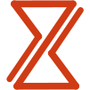
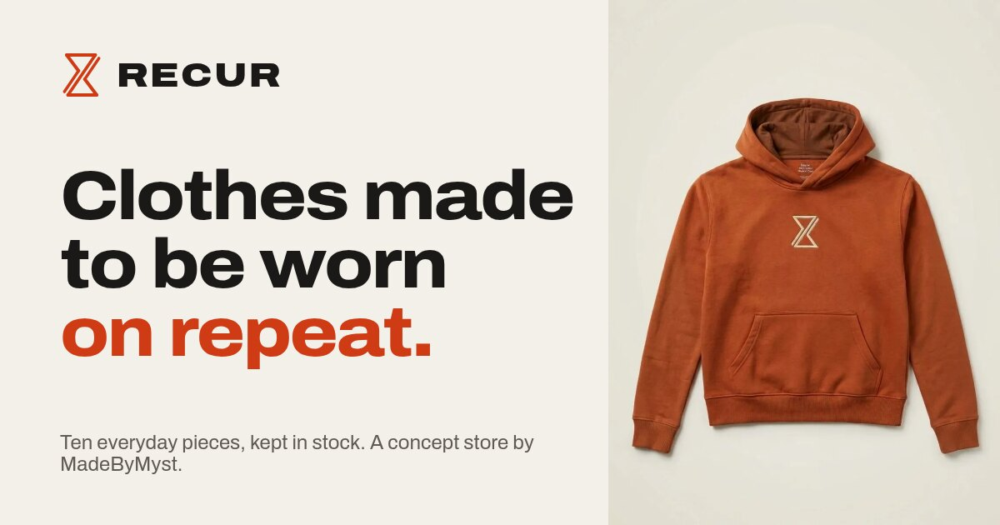

<div align="center">



# RECUR

### Clothes made to be worn on repeat.

[](https://madebymyst.github.io/recur/)

</div>

> **This is a concept project.** RECUR isn't a real brand. The clothes, prices, stock, founders, factory and reviews are made up, and the checkout never takes any money.



An online store for a made-up streetwear brand, designed and built by [MadeByMyst](https://madebymyst.github.io/). The brand has one idea: no limited drops. It sells ten pieces, and when one sells out it comes back, with the date on the product. That's where the name comes from.

## What's in the store

- **Home:** the hero, the four pieces people buy most, the idea behind the brand, one piece up close, shop by type, an overshirt that's back soon and one customer's words
- **Shop:** all ten pieces with filters and sorting, plus a "Coming back" list of every sold-out size and its date
- **Our idea:** a note from Walter and Jesse, the (made-up) founders, how the brand is run, and the mark, which turns over when you click it
- **Help:** size guide, delivery, returns and repairs, common questions and contact details
- **Checkout:** contact, address and delivery, with a running total. The payment step is replaced by a note saying this is a demo.

On every page:

- **Product popups.** Pick a colour and size, see what's in stock, and add it to the bag. Sold-out sizes say when they're back and offer an email alert instead. Links like `shop.html#loop-hoodie` open straight into a product.
- **A bag** that slides in from the side, remembers what's in it and shows how far you are from free delivery.
- **Light and dark themes.** The site follows your system setting until you pick one, and remembers your choice.
- **A live delivery line**, e.g. "Order in the next 2 h 10 min and it ships today", worked out from your own clock.

## Simple on purpose

- Plain HTML, CSS and JavaScript. No frameworks, no build step.
- One font family (Archivo), using its width axis for the wide headings.
- The logo is a small inline SVG, so it takes on each theme's colour.
- Restock dates are counted from today, so the demo never goes out of date.
- Works on phones, tablets and desktops, works with the keyboard, and respects "reduce motion" settings.

## Product photos

The product photos were made by Myst with Google Gemini. Each one is cropped to 4:5 and saved as WebP in `assets/products/`, named `<product>-<colour>.webp`. The full-size originals are kept out of the repo.

To change a photo, replace its file in `assets/products/` with one of the same name:

- Size: **960 × 1200 px** (4:5), saved as WebP
- Plain light background, product centred, with some space around it

| Product | Files |
|---|---|
| Loop Hoodie | `loop-hoodie-rust`, `loop-hoodie-black`, `loop-hoodie-white` |
| Everyday Tee | `everyday-tee-white`, `everyday-tee-black`, `everyday-tee-olive` |
| Heavy Crew | `heavy-crew-grey`, `heavy-crew-black` |
| Overshirt | `overshirt-black` |
| Work Pant | `work-pant-black`, `work-pant-stone` |
| Fleece Short | `fleece-short-grey`, `fleece-short-black` |
| Six-Panel Cap | `six-panel-cap-black`, `six-panel-cap-rust` |
| Rib Beanie | `rib-beanie-rust`, `rib-beanie-black` |
| Canvas Tote | `canvas-tote-natural`, `canvas-tote-black` |
| Crew Socks | `crew-socks-white`, `crew-socks-black` |

## Files

| File | What it does |
|---|---|
| `index.html`, `shop.html`, `about.html`, `help.html`, `checkout.html` | The pages |
| `styles.css` | Design tokens at the top (light and dark), then each part, written mobile-first |
| `products.js` | The catalogue: products, colours, sizes, stock and size guides |
| `script.js` | Theme switch, header, mobile menu, scroll effects, accordions and the delivery line |
| `store.js` | Product cards, the popup, the bag, filters, the restock list and the checkout |

The size guide tables on `help.html` repeat the numbers in `products.js`, so change both together.

To run it locally, open `index.html` in a browser, or serve the folder:

```bash
python3 -m http.server
```

## Credits

| Asset | Source |
|---|---|
| Product photos | Made by MadeByMyst with Google Gemini |
| Font | Archivo from [Google Fonts](https://fonts.google.com/) |
| Logo | The MadeByMyst mark, recoloured for RECUR |

---

<div align="center">

Made by **[MadeByMyst (Shahab MD)](https://madebymyst.github.io/)**, front-end developer based in Oman.

[](https://www.instagram.com/_mystiqdev72/)
[](https://www.linkedin.com/in/mystique-x-9572b93a7/)

</div>
